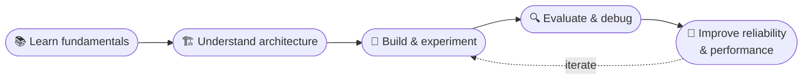

<!-- ═══════════════════════  HEADER  ═══════════════════════ -->
<div align="center">

<a href="https://github.com/priteshbeladiya07">
  
</a>
<br/>
<a href="https://github.com/priteshbeladiya07"></a>

 
</div>
<br/>
<!-- ═══════════════════════  ABOUT (BENTO)  ═══════════════════════ -->
<table>
<tr>
<td width="58%" valign="top">
### 👨‍💻 &nbsp;whoami
 
```python
class Pritesh:
    role     = "AI Engineer (in the making)"
    studying = "B.Tech · Electronics & Communication"
    focus    = ["GenAI", "Agentic workflows", "RAG", "Backend"]
    mindset  = "Build → Evaluate → Improve"
 
    def mission(self):
        return "Ship AI systems that are fast, reliable & useful"
```
 
</td>
<td width="42%" valign="top">
### 🔭 &nbsp;Currently
 
- 🤖 Building **agentic workflows** with LangGraph
- 🔌 Exploring **MCP** for tool use
- 🔎 Going deep on **advanced RAG** & context engineering
- ⚡ Tuning **latency, throughput & token budgets**
</td>
</tr>
</table>
> [!NOTE]
> I believe AI engineering is about more than generating an answer. It's about building systems that **retrieve** the right information, **use tools** appropriately, **handle failures**, and **deliver results efficiently**.
 
<br/>
<!-- ═══════════════════════  TECH STACK  ═══════════════════════ -->
## ⚡ Tech Stack
 
<details open>
<summary><b>🧠 &nbsp;AI · ML · LLM Engineering</b></summary>
<br/>
<p>
  
</p>
<p>
  
  
  
</p>
<p>
  
  
  
  
</p>
</details>
<details open>
<summary><b>⚙️ &nbsp;Backend · Databases · DevTools</b></summary>
<br/>
<p>
  
</p>
<p>
  
  
  
</p>
</details>
<details open>
<summary><b>💻 &nbsp;Languages</b></summary>
<br/>
<p>
  
</p>
</details>
<details>
<summary><b>🔌 &nbsp;Electronics &amp; Hardware Design</b></summary>
<br/>
<p>
  
  
  
</p>
</details>
<br/>
<!-- ═══════════════════════  AREAS OF INTEREST  ═══════════════════════ -->
## 🧩 Areas of Interest
 
| | Area | What I explore |
|:-:|:--|:--|
| 🤖 | **Agentic AI** | Tool calling · routers · orchestrators · multi-step workflows |
| 🔎 | **Advanced RAG** | Corrective RAG · Self-RAG · GraphRAG · semantic search |
| 🧠 | **Context Engineering** | Retrieval · conversation history · context management |
| 🛡️ | **LLM Engineering** | Tracing · evaluation · guardrails · reliability |
| 🏗️ | **AI System Design** | Throughput · concurrency · caching · latency · token budgets |
| ⚙️ | **Backend Engineering** | FastAPI · REST APIs · authentication · databases |
| 🚢 | **Deployment** | Docker · environment configuration · app deployment |
 
<br/>
<!-- ═══════════════════════  GITHUB STATS  ═══════════════════════ -->
## 📊 GitHub Stats
 
<div align="center">
<a href="https://github.com/priteshbeladiya07">
  <picture>
    <source media="(prefers-color-scheme: dark)" srcset="https://github-readme-stats.vercel.app/api?username=priteshbeladiya07&show_icons=true&theme=tokyonight&hide_border=true&bg_color=0D1117&title_color=38BDF8&icon_color=38BDF8&include_all_commits=true&count_private=true" />
    <source media="(prefers-color-scheme: light)" srcset="https://github-readme-stats.vercel.app/api?username=priteshbeladiya07&show_icons=true&theme=default&hide_border=true&title_color=0369A1&icon_color=0369A1&include_all_commits=true&count_private=true" />
    
  </picture>
</a>
<a href="https://github.com/priteshbeladiya07">
  <picture>
    <source media="(prefers-color-scheme: dark)" srcset="https://github-readme-stats.vercel.app/api/top-langs/?username=priteshbeladiya07&layout=compact&theme=tokyonight&hide_border=true&bg_color=0D1117&title_color=38BDF8&langs_count=8" />
    <source media="(prefers-color-scheme: light)" srcset="https://github-readme-stats.vercel.app/api/top-langs/?username=priteshbeladiya07&layout=compact&theme=default&hide_border=true&title_color=0369A1&langs_count=8" />
    
  </picture>
</a>
<br/>
<a href="https://github.com/priteshbeladiya07">
  <picture>
    <source media="(prefers-color-scheme: dark)" srcset="https://streak-stats.demolab.com?user=priteshbeladiya07&theme=tokyonight&hide_border=true&background=0D1117&ring=38BDF8&fire=38BDF8&currStreakLabel=38BDF8" />
    <source media="(prefers-color-scheme: light)" srcset="https://streak-stats.demolab.com?user=priteshbeladiya07&theme=default&hide_border=true&ring=0369A1&fire=0369A1&currStreakLabel=0369A1" />
    
  </picture>
</a>
</div>
<!-- Optional: contribution activity graph -->
<div align="center">
  <picture>
    <source media="(prefers-color-scheme: dark)" srcset="https://github-readme-activity-graph.vercel.app/graph?username=priteshbeladiya07&bg_color=0D1117&color=38BDF8&line=0369A1&point=FFFFFF&area=true&area_color=0369A1&hide_border=true" />
    <source media="(prefers-color-scheme: light)" srcset="https://github-readme-activity-graph.vercel.app/graph?username=priteshbeladiya07&bg_color=FFFFFF&color=0369A1&line=38BDF8&point=0F172A&area=true&area_color=38BDF8&hide_border=true" />
    
  </picture>
</div>
<br/>
<!-- ═══════════════════════  FEATURED PROJECTS  ═══════════════════════
  Replace REPO_NAME_1 / REPO_NAME_2 with your real repo names, then remove
  the comment markers (this line and the closing line below) to enable it.
## 🚀 Featured Projects
<div align="center">
  <a href="https://github.com/priteshbeladiya07/REPO_NAME_1">
    
  </a>
  <a href="https://github.com/priteshbeladiya07/REPO_NAME_2">
    
  </a>
</div>
═══════════════════════════════════════════════════════════════ -->
 
<!-- ═══════════════════════  ENGINEERING MINDSET  ═══════════════════════ -->
## 📈 My Engineering Mindset
 

 
<br/>
<!-- ═══════════════════════  CONNECT  ═══════════════════════ -->
<div align="center">
## 🌐 Let's Connect
 
<a href="https://github.com/priteshbeladiya07">
  
</a>
<br/><br/>
 
**Learn continuously. Think deeply. Build intelligently.**
 
<sub>Exploring the intersection of software engineering and artificial intelligence.</sub>
 

</div>
 
